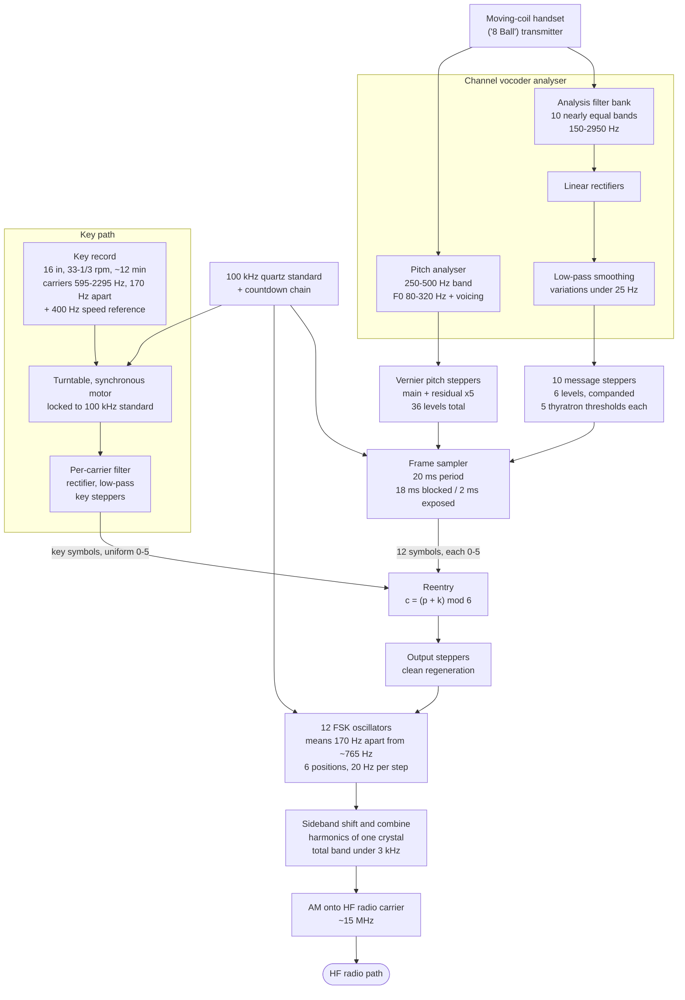
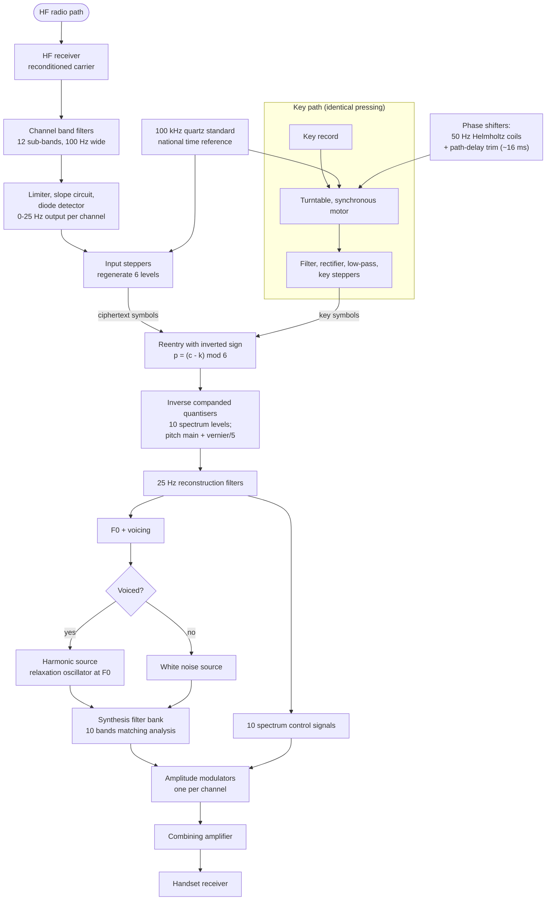

# SIGSALY architecture

Engineering description of the Bell Telephone Laboratories "X System" (Signal Corps codename SIGSALY,
also Ciphony I, nicknamed "Green Hornet"), 1943-1946, written as an implementation specification for
`pysigsaly`.

Every figure is attributed; see [References](#references). Where sources disagree, the range is given and
the disagreement flagged. Nothing here derives from classified material: the basic patents and system
details were withheld until 1975-1976 and then published [1][5].

The two most authoritative technical sources are R. L. Miller's chapter on Project X in the Bell System's
own engineering history [1] and the wartime Bell Labs patents [7]-[13], which give tone plans, timing and
circuit structure directly. NSA's Center for Cryptologic History account [2] supplies the operational and
key-management detail.

---

## 1. System context

### 1.1 Problem

Allied strategic voice traffic crossed the Atlantic on the AT&T HF radiotelephone circuit, protected by
the pre-war commercial A-3 privacy system. A-3 split the 250-3000 Hz band into five sub-bands (nominally
250-800, 800-1350, 1350-1900, 1900-2450, 2450-3000 Hz), permuted and selectively inverted them, changed
the arrangement every 15-20 s, and cycled its key after 36 steps, using only six of the 3,840 possible
arrangements [24]. From September 1941 the Forschungsstelle der Deutschen Reichspost under Kurt
Vetterlein, working from Noordwijk in the occupied Netherlands, descrambled Washington-London calls in
real time at 30-60 calls a day, and in July 1943 obtained advance warning of the Italian armistice from a
Roosevelt-Churchill conversation [24].

Miller states the design principle that followed directly: every band-scrambling scheme is "just a complex
way of transmitting speech that a person could undo with the necessary equipment and enough time" — a
*privacy* system, not a *secrecy* system. A secrecy system must remain unbreakable to an eavesdropper who
owns identical equipment and lacks only the key [1].

The solution was to stop transmitting speech. A channel vocoder reduces speech to twelve slowly varying
control parameters; each is quantised to six levels; a never-repeated random key is added to the quantised
values in modular arithmetic. The transmitted signal retains no residue of the original waveform.

### 1.2 Deployment scale

| Property | Value | Source |
|---|---|---|
| Racks per terminal | "over 30" standard 7-foot relay rack bays [1]; "about forty racks" [2][4] | [1][2][4] |
| Power | ~30 kW, full air conditioning required | [1][2] |
| Weight | ~55 tons | [2][3]; "50,000 kg" [14] |
| Floor area | ~2,500 sq ft | [21] |
| Efficiency, as the engineers put it | 30 kW in for 1 mW of poor-quality speech out | [1] |
| Terminals | ~12 worldwide | [2][4][19] |
| First operational conference | 15 July 1943, Pentagon <-> London | [2][4] |
| Withdrawn | 1946 | [15] |
| Conferences carried | >3,000 | [2][4][21] |
| Operating unit | 805th Signal Service Company, 81 officers / 275 enlisted; 186 Signal Corps personnel trained by Bell Labs | [1][2][21] |
| Duty cycle | ~8 h/day operation, ~16 h/day maintenance | [2][15] |

First terminals were installed in Washington, London and North Africa by end of April 1943; later
terminals went to Paris, Hawaii, Australia, the Philippines, Guam, Manila, and post-war Berlin, Frankfurt
and Tokyo [1][2]. One Philippines-bound terminal was soaked in the surf at Port Moresby, cleaned, and put
into service on a barge [1]. The handset used a ball-shaped transmitter adapted from the Western Electric
"8 Ball" high-quality microphone, because carbon transmitters lacked bass response for male voices [1][5].

A miniaturised successor, **Junior X / AN-GSQ-3**, reduced the terminal to six 5-foot bays in a trailer
van by cutting to 8 spectrum channels, multiplexing one quantiser/reentry unit across all channels
(a 12:1 reduction in coder hardware), and using miniature tubes. It was delivered in March 1946, too late
for the war [1][12].

### 1.3 Channel constraints

The link was HF (short-wave) radiotelephone; Bennett gives ~15 MHz, the only figure located and therefore
single-sourced [5]. Constraints that shaped every design decision [1]:

* **Selective fading up to 20 dB.** A six-level amplitude-modulated signal would need amplitude accuracy
  of about +/-10% (1 dB) to be decoded correctly. That is impossible over the transatlantic path, so
  amplitude modulation was ruled out and FSK adopted.
* **Multipath delay spread of 2-3 ms.** The symbol interval had to be much longer than this, which sets
  the 20 ms frame directly.
* **~3 kHz of usable baseband.** The whole 12-channel multiplex had to fit inside an ordinary telephone,
  carrier or radio channel [9].

Miller's own summary of the achievement: "today's equivalent of about 1,500 bits per second was
transmitted and maintained in complete synchronism over the fading of the transatlantic shortwave radio
with only occasional errors" [1]. The system failed at roughly the same time the ordinary commercial
transatlantic radiotelephone became unusable; transpacific links behaved somewhat better [1].

---

## 2. Vocoder front end

The analyser is Homer Dudley's channel vocoder [7][18], with the pitch path extended for SIGSALY.

### 2.1 Analysis filter bank

**Primary statement [1]:** the speech spectrum "is first divided into ten nearly equal bands in the range
of 150 Hz to 2,950 Hz."

#### 2.1.1 Dudley's telephone-band vocoder — fully documented

Dudley's own account of the vocoder gives the bank exactly [8]: ten spectrum-analysing channels, the first
covering 0-250 c/s and the other nine 300 c/s wide from 250 c/s to 2950 c/s, "a top frequency which is
representative of commercial telephone circuits". That is:

| Ch | Band (c/s) | Ch | Band (c/s) |
|---|---|---|---|
| 1 | 0-250 | 6 | 1450-1750 |
| 2 | 250-550 | 7 | 1750-2050 |
| 3 | 550-850 | 8 | 2050-2350 |
| 4 | 850-1150 | 9 | 2350-2650 |
| 5 | 1150-1450 | 10 | 2650-2950 |

A 30-channel wideband vocoder was also built as a laboratory instrument [8]. Dudley's earlier patent [7]
specifies a *different*, progressively widening bank over the full 250-7100 c/s speech range
(250-530, 530-780, 780-1100, 1100-1500, 1500-1950, 1950-2350, 2350-2900, 2900-3750, 3750-4950,
4950-7100 c/s). Both are Dudley's; they are different designs for different bandwidths, and neither is
SIGSALY's.

#### 2.1.2 SIGSALY's bank

SIGSALY's is the telephone-band design shifted up at the bottom: ten nearly equal bands over
**150-2950 Hz** [1], corroborated independently by Crypto Museum [14]. The figure accompanying [1]
(Fig. 5-31) labels only three of the ten filters — **150-350, 350-550 and 2650-2950 Hz** — leaving
channels 3-9 unlabelled. *Caveat: those figure labels are read from the raster figure; the text layer of
the PDF does not contain them, so this document could not verify them by text extraction.*

**Recommended default.** The three labelled bands plus the stated 150-2950 Hz span are satisfied exactly
by taking Dudley's telephone-band table [8] and replacing its 0-250 and 250-550 pair with 150-350 and
350-550:

| Ch | Low (Hz) | High (Hz) | Width |
|---|---|---|---|
| 1 | 150 | 350 | 200 |
| 2 | 350 | 550 | 200 |
| 3 | 550 | 850 | 300 |
| 4 | 850 | 1150 | 300 |
| 5 | 1150 | 1450 | 300 |
| 6 | 1450 | 1750 | 300 |
| 7 | 1750 | 2050 | 300 |
| 8 | 2050 | 2350 | 300 |
| 9 | 2350 | 2650 | 300 |
| 10 | 2650 | 2950 | 300 |

**Channels 3-9 here are inference, not a citation.** They are the unique completion consistent with the
three labelled bands, the 150-2950 Hz span, "nearly equal" widths, and Dudley's documented 300 Hz spacing.
No source publishes SIGSALY's channels 3-9.

Competing claims, for the record:

| Source | Claim |
|---|---|
| Miller, Bell System history [1] | ten **nearly equal** bands, 150-2950 Hz |
| Crypto Museum [14] | 150-2950 Hz over 10 nearly equal channels (agrees with [1]) |
| Dudley, Bell Laboratories Record [8] | *his* vocoder: 0-250 plus nine 300 c/s bands to 2950 |
| Hass [20] | same as [8], restated |
| NSA Cryptologic Quarterly [3] | ten filters "spaced approximately at the bands of **equal articulation** for speech, from baseband up to 3000 Hz" |
| Boone & Peterson [2], jproc [15], OH-KY-IN [22] | ten channels, "generally 250-3000 Hz" |
| Wikipedia [19], Smith [18] | 250-2950 / 250-3000 Hz |
| Dudley, US 2,151,091 [7] | a different, progressively widening bank over 250-7100 c/s |

**Flagged conflict.** The 250-2950 and 250-3000 figures in [2][15][18][19][22] appear to be roundings that
silently drop the lowest band; they are not independent measurements. The real conflict is between [1]'s
"nearly equal" bands and [3]'s "equal articulation" spacing, which implies bands widening with frequency.
[1] is Bell Labs' own history of this specific system and is adopted here. An emulator should ship the
equal-articulation (mel- or Greenwood-warped) layout as an alternative preset, along with the two
documented Dudley banks.

### 2.2 Envelope detection

Per [1]: the amplitude in each band is obtained with a **linear rectifier** and smoothed by a low-pass
filter "which limits the variations to less than 25 Hz". The same 25 Hz limit is applied to the pitch
signal [1].

The 25 Hz figure is unusually well corroborated. Dudley states it directly for the vocoder: each
spectrum-analysing channel is a band filter, then a rectifier, then **a 25-cycle low-pass filter**, which
retains the power-indicating current while eliminating the original speech frequencies [8]. The pitch
channel's filter is likewise labelled 0-25 c/s [8]. Bennett gives 0-25 Hz per channel [5]; Crypto Museum
agrees [14]. Dudley's earlier patent used a 20 c/s low-pass instead [7].

The rectifier is specified as **linear** [1], not square-law.

25 Hz is the Nyquist justification for the 50 Hz frame rate.

The rectify-and-smooth output is a short-term magnitude, not power; since the quantiser that follows is
logarithmic, the distinction is a fixed offset.

### 2.3 Pitch and voicing

Per [1], the auxiliary analysis determines whether the sound is **voiced** (vowels and voiced consonants)
or **unvoiced** (sibilants and fricatives), and if voiced, measures the fundamental frequency. Both vary
slowly and are limited by the same 25 Hz low-pass.

Dudley's own description of the pitch channel [8]: a frequency-discriminating network delivers the
fundamental in reasonably pure form; a **frequency meter** counts the current reversals as roughly uniform
pulses; a 0-25 c/s filter removes the speech frequencies and retains a slowly changing current that is a
direct measure of pitch. His patent adds the band selection and range: the 250-500 c/s band is selected
(guaranteeing at least two harmonics), detected with emphasis on the lower harmonics, and
amplitude-normalised in a constant-output amplifier; the recovered fundamental spans **80-320 c/s** [7].
Use 80-320 Hz as the emulator's pitch search range; it also explains the system's documented weakness on
higher-pitched voices [5].

**How the pitch channel was represented.** Pitch proved far more sensitive to quantisation than the
spectrum channels: experiments showed it needed "some 30 or more steps", and spending five whole channels
on it was unacceptable [1]. Badgley and Miller's **vernier** scheme solved this with two channels [1][11]:

1. Quantise the pitch signal with the standard six-level stepper (five steps above zero) — the *main* value.
2. Subtract the main stepper's quantised value from the original pitch signal, leaving a residual.
3. Scale the residual up and quantise it with an identical six-level stepper — the *vernier* value.
4. At the receiver, divide the vernier value back down and add it to the main value.

Result: **36 pitch levels from two six-level channels** ([1]: "N^2 or 36 levels with two channels";
[11]: "a total of thirty-five steps above zero").

*Flagged conflict on level spacing.* Bennett reports the 36 pitch levels as "distributed logarithmically"
[5]. [1] describes the vernier as a plain linear residual — subtract the coarse reconstruction, scale by
five, re-quantise — which is not a logarithmic scale. These are in tension; the logarithmic claim rests on
a single secondary source. Note also that [20] gives "30 step values", which is the *requirement* stated
in [1] ("some 30 or more steps"), not the 36 that were delivered.

*Flagged minor discrepancy:* the scaling factor between the two steppers is given as **five** in [1] (the
residual is at most one fifth of the stepper's input range) and as **six** in the patent [11]. Both yield
36 combined levels. The factor follows from whether the coarse step is defined as range/5 or range/6; an
emulator should pick one and be consistent between encoder and decoder.

Miller generalises the idea explicitly: the vernier is M-ary coding, and binary was considered at the time
as just one of the possible combinations [1].

**Voiced/unvoiced.** [1] describes voicing as an auxiliary determination that selects the harmonic source
or the white-noise source at the synthesiser.

For **Dudley's vocoder** the mechanism is documented and requires no extra channel: unvoiced sounds have
too little power to operate the frequency meter, so the pitch-defining current is proportional to pitch
for voiced sounds and **equal to zero for unvoiced sounds** [8]. Zero pitch *is* the unvoiced flag.

For **SIGSALY** this is **not confirmed**. [1] never states it and its system diagram shows only a pitch
detector feeding the main and vernier steppers. [2] says only that the two channels carried pitch "as well
as whether or not unvoiced (hiss) energy was present", without giving the mechanism. Reserving the zero
pitch code is the obvious way to fit voicing into twelve channels and follows Dudley's documented
convention [8], so it is adopted here — but it is an inference.

*Flagged alternative reading:* IEEE Spectrum describes the parameter set as "10 frequency sub-bands, a
pitch parameter, and a bit that indicated whether the speech sound was voiced or unvoiced" [16], i.e.
channel 12 as a voicing flag rather than a pitch vernier. That contradicts [1] and [11] and is not adopted.

**Channel count over time.** The 1942-vintage patents [9][10] work through eleven channels (ten spectrum +
one pitch). The fielded X System had **twelve** — ten spectrum plus the two-channel vernier pitch pair
added by [11] — and Miller states this plainly: "The X System was made up of 12 parallel channels
(10 spectrum, 2 pitch), which were nearly duplicates of each other except for their frequency position in
the FSK arrangement" [1].

**Net parameter set per 20 ms frame: 12 values, each 0-5.**

---

## 3. Sampling and quantisation

| Parameter | Value | Source |
|---|---|---|
| Frame rate | 50 frames/s | [1][5][14][15] |
| Frame period | 20 ms | [1][2][3][9][10] |
| Parameters per frame | 12 (10 spectrum + 2 pitch) | [1] |
| Levels per parameter | 6 | [1][2][5][6] |
| Spectral level spacing | non-linear, "instantaneous companding" | [1]; logarithmic per [3][15] |
| Pitch levels | 36, from the two-channel vernier | [1][5][11] |
| Symbol rate | 12 x 50 = 600 six-ary symbols/s | derived |
| Entropy rate | 600 x log2(6) ~= 1550 bit/s | derived |
| Rate quoted by Bell Labs | "about 1,500 bits per second" | [1] |
| Rate quoted by NSA | ~1200 bit/s | [3], but see below |

**On the rate.** The derived entropy figure (600 x log2 6 = 1550.6 bit/s) agrees with Bell Labs' own
published statement of "about 1,500 bits per second" [1] to within rounding. Use ~1500-1550 bit/s.

The 1200 bit/s figure should be handled carefully. [3]'s sentence describes the post-war KO-6 as "a close
approximation to the 1200-bps SIGSALY voice coder"; 1200 bit/s is independently the published rate of the
**KO-6** itself (as 1650 bit/s is the KY-9's), so the phrasing is ambiguous about which system the number
belongs to. It is inconsistent with SIGSALY's own documented 12 x 50 x six-level format. Quote it only
with that caveat.

### 3.1 Why six levels, why 20 ms

Both numbers are documented engineering compromises, not arbitrary choices [1]:

* **Levels.** M. E. Mohr built what was probably the first quantiser, adjustable up to ten levels, and the
  vocoder was tested at each setting. More levels improve vocoder quality but shrink the transmission
  margin for FSK over transatlantic radio. Six was "somewhat over the knee of the curve" for quality and
  still transmissible. It was chosen early and never changed.
* **Non-linear steps.** Instantaneous companding (non-uniform step spacing) was tried late in the level
  trials and gave an improvement; who proposed it was never recorded [1]. NSA describes the result as six
  logarithmically spaced amplitudes [3].
* **Frame period.** The vocoder wanted 50 Hz sampling; transatlantic selective fading arises from path
  delay differences of 2-3 ms, so the symbol interval had to be much longer. 20 ms satisfied both [1].

### 3.2 Quantiser realisation

The wartime circuit ("stepper") is a flash converter. Per the reconstruction project [16][17]: five
VT-109 / 2051 argon thyratrons per quantiser act as strobed comparators fed from a five-tap **logarithmic**
resistor divider ladder, firing in sequence to produce a thermometer code (not a binary code); the six
output levels are zero plus the five detected thresholds. SIGSALY used 72 identical quantisers for the 12
message parameters and the key [16]; ~384 type 2051 thyratrons per terminal are reported by [15] and [2].

**Do not treat the reconstruction's component values as historical.** The 25 V full scale, ~1.0 V ladder
tap voltages and 2.5-3.0 V cathode bias in [17] are the author's own re-creation design, not recovered
SIGSALY specifications. **No located source publishes the original ladder resistor values, the six level
boundaries, or the step spacing in dB** — not [1], not [2], not [3], not [16] or [17]. Threshold placement
in an emulator is therefore a design choice, constrained only by "logarithmic" and "six levels".

The patents give the strobe timing precisely: within each 20 ms period the stepper tubes are held blocked
for 18 ms (grid at about -150 V) and exposed for 2 ms (grid at about -4 V) [9]; equivalently, the steppers
are "exposed to the noise waves at the beginning of each 18-millisecond interval and restored at the end"
[10]. The basic stepper and reentry circuits were designed by Lundstrom and Schimpf [1][9], simplified by a
suggestion from Dudley [1].

### 3.3 Consequences for an emulator

* The quantiser is 5 thresholds delimiting 6 levels.
* Spectral-channel thresholds are geometrically spaced over the channel's working dynamic range.
* The decoder maps a level index to a representative amplitude (mid-tread of the log interval).
* **The key quantiser is a different quantiser.** Key noise was quantised into "six levels of equal
  probability" [2][22] — thresholds at the sextiles of the noise amplitude distribution, not log-spaced.
  Equiprobable key symbols are precisely what makes the modulo sum uniform (section 5.1).

---

## 4. Key material

### 4.1 Generation

* **Source.** A hot-cathode gas discharge tube, chosen because it "produces noise waves of enough energy
  so that only moderate amplification is needed" [10]. Boone & Peterson describe the deployed source as
  large mercury-vapour rectifier tubes, four inches in diameter and fourteen inches high, producing
  wideband thermal noise [2]. Bennett calls it a gas tube noise source [5]. These are physically random
  (ionisation/shot noise), not algorithmic.
* **Sampling and quantisation.** The noise is sampled once per 20 ms period and quantised to **six levels
  of equal probability** [2][10][22]. Equal probability is the quality-control criterion: it makes each key
  symbol uniform on {0..5}, the precondition for a one-time pad over Z6.
* **Whitening.** No statistical test regime is described in the located sources. Treat wartime "quality
  control" as: physical entropy source, sextile-placed thresholds giving equiprobable symbols, and single
  use followed by destruction.
* **A non-record key generator existed.** Busch, Myers and Joel built a relay-based "mechanical" key
  source nicknamed the "threshing machine". Its theoretical security was not absolute, so it was never
  used for high-priority calls, but it was valuable for line-up and testing without consuming precious
  records [1]. An emulator's pseudorandom test mode is the direct analogue of this device, and should be
  labelled as such.

### 4.2 What is on the record

Not a raw symbol stream. Each key channel amplitude-modulates its own carrier, and all carriers are
combined into one recording head [10]:

| Property | Value | Source |
|---|---|---|
| Key carriers | spaced **170 c/s**, lowest **595 c/s**, highest **2295 c/s** (11-channel example) | [10] |
| Sync/speed-control tone | a separately recorded standard-frequency wave, "This frequency may be 400 cycles", used for synchronising or speed control of the record | [10] |
| Deployed system | sum of 12 voice-band carriers, each modulated by a train of six-level pulses | [5] |
| Alternative carrier plan | 750, 1250, ... up to 5750 c/s in Dudley's US 3,985,958 — a *different* plan from [10]; the patents disagree | reported in [10] vs. that patent |

Recovery is per-carrier band filter -> rectifier -> low-pass filter -> key stepper, which regenerates the
six-level value; this chain is spelled out in [12] ("key band-pass filter ... rectified ... filtered in
low-pass filter ... applied to the key stepper, which may be a duplicate of the message stepper"). Note
the 595 c/s key carrier plan and the 765 c/s FSK plan (section 6) are offset by exactly one 170 c/s slot.

### 4.3 Records, distribution, discipline

| Property | Value | Source |
|---|---|---|
| Medium | 16-inch phonograph records; wax masters, vinyl then acetate-on-aluminium pressings | [2][14][16][23] |
| Speed | 33-1/3 rpm | [16][23] |
| Codenames | SIGGRUV (voice key), SIGJINGS (sync/timing key) | [14] |
| Duration | ~12 minutes of key plus several functional signals [2]; Bennett says 15-minute discs [5] |  |
| Copies | "only two records were ever made before a master was destroyed" [1]; Bennett agrees, two and only two [5]; Boone & Peterson say three [2] |  |
| Recording precision | very precisely driven turntables used for cutting as well as for playback [1] |  |
| Distribution | armed courier from Arlington Hall Station; held in safes at terminals | [2][5] |
| Destruction | destroyed immediately after use; no wartime key record survived | [5] |
| Changeover | two turntables per direction per terminal, switch from one disc to the next without a break | [5] |

**Flagged disagreements:** record duration 12 min [2][14][15] vs 15 min [5]; copies per master 2 [1][5] vs
3 [2]. Adopt 12 minutes and 2 copies (the latter is stated by Bell Labs' own history [1]).

At 50 frames/s and 12 symbols/frame, 12 minutes of key is 720 s x 600 = **432,000 six-ary symbols**
(~1.12 Mbit of entropy); 15 minutes would be 540,000 symbols.

### 4.4 One-time-pad discipline

Miller states the requirement explicitly: the key must be not only completely random but **never
repeated** [1]. Operationally that meant: a fresh identical pair of records per conference; discs
destroyed after a single play; master destroyed after pressing; exactly two (or three) copies in
existence. Each direction of a duplex conversation consumed its own key, so each terminal held two sets of
records and two pairs of turntables [5].

---

## 5. Encryption: "reentry"

Let the quantised parameter for channel *i* in frame *n* be `p[i,n]` in {0..5} and the key symbol
`k[i,n]` in {0..5}.

Transmit: `c[i,n] = (p[i,n] + k[i,n]) mod 6`
Receive:  `p[i,n] = (c[i,n] - k[i,n]) mod 6`

The historical name for this is **reentry**. It came from a discussion on 27 May 1941 between R. K. Potter
and H. Nyquist, who concluded that the sum of key and message should "fall as points on a circle": if the
sum exceeds the maximum level it re-enters at the bottom, like a clock hand continuing round the face [1].
Miller's own statement of the rule: with message M, key K and C = n+1 levels, the reentered value is the
sum reduced modulo C; decoding subtracts the key and adds n+1 if the result is negative [1]. The design is
Vernam's telegraph one-time pad [1] generalised from base 2 to base 6.

The path to it is instructive. Potter first proposed treating each vocoder channel as on/off via a biased
relay — a direct Vernam analogue — but Gruenz's experiments showed it mutilated vocoder speech. Two relays
per channel helped; it became clear that many step values were needed. Only when the N-level dimension was
admitted did the thinking break free of treating the 10-channel on/off pattern as a telegraph character,
and only then did the question "how do you add a multilevel key?" arise [1].

In the terminal, after reentry another stepper regenerates the quantised signal cleanly before it drives
the FSK oscillators [1].

### 5.1 Why modulo arithmetic flattens the ciphertext

Addition modulo *N* makes {0..N-1} a cyclic group. For any fixed plaintext symbol *p*, the map
`k -> (p + k) mod N` is a bijection on the alphabet. If *k* is uniform on {0..N-1} and independent of *p*,
then `c` is uniform on {0..N-1} whatever the distribution of *p*, and `I(p; c) = 0`. Miller makes exactly
this argument for six levels: any signal value, reentered, can produce any one of the six values depending
on the key, so a random key produces an equally random transmitted sequence [1].

This is why the two quantisers differ: speech symbols are heavily skewed (most channels are near-silent
most of the time) and are quantised logarithmically for quality, while key symbols are quantised at the
sextiles specifically to be uniform [2][22]. Only a uniform key erases the plaintext skew.

Practically, the radiated signal shows no speech-rate structure, no formant motion and no silence pattern —
just a constant tone complex. The nickname "Green Hornet" came from the audible control tones resembling
the signature theme of a well-known radio programme [1]. A post-war investigation team found a German
intercept station that had recorded reams of the signal and concluded it was the output of a complicated
telegraph system [1].

Non-modular alternatives fail: saturating addition leaks the plaintext at the range extremes, and XOR is
not closed on a base-6 alphabet.

### 5.2 Why alignment is mandatory

The cipher has zero tolerance in key index. If the receiver's key is offset by one frame, every recovered
symbol becomes `(p[i,n] + k[i,n] - k[i,n-1]) mod 6`, which is uniform noise. There is no partial
decryption and no graceful degradation — the output is unintelligible, not merely degraded. A one-symbol
slip is as fatal as a wholly wrong key [5]. Hence section 8.

---

## 6. Transmission

### 6.1 Why FSK

A six-level amplitude-modulated signal requires amplitude fidelity of about +/-10% (1 dB). Transatlantic
selective fades reached 20 dB, so AM was ruled out. FSK had been proven on two-level telegraph, and the
extension was to use **six frequency positions in each of 12 channels** [1].

Two hard design problems came out of it: the frequency-shift oscillators (M. E. Mohr, built around a
saturated-core inductor) needed accuracy, stability and freedom from transients at pulse transitions; and
the limiter-detectors (L. G. Schimpf) had to slice multilevel pulses reliably. Optimum filtering for
sampling multilevel pulses — today's "eye pattern" problem — was solved for this system by W. R. Bennett
as an extension of Nyquist's telegraph theory [1].

### 6.2 The tone plan

From the X System transmission patent [9]:

| Parameter | Value |
|---|---|
| Oscillator mean frequencies | 170 c/s apart, lowest "say, 765 cycles" |
| Per-channel band filter | 100 c/s wide, with the channel mean frequency **at one edge** |
| Frequency deviation | 100 c/s from mean, one-sided (only components on one side of the mean are transmitted) |
| Total transmitted band | **within 3 kilocycles**; transmissible over an ordinary telephone circuit, carrier channel or radio channel |
| Channels in the patent example | 11 (ten spectrum + one pitch) |

Six levels spanning a 100 c/s one-sided deviation implies **20 c/s per step**. That step size is confirmed
independently by the Junior X signalling patent, which gives channel normal frequencies "such as 500, 700,
900, etc. cycles" and states each "may be shifted 20 cycles per step or a total of 100 cycles" [12].
(Junior X used 200 c/s channel pitch rather than 170; Miller notes that cutting to 8 spectrum channels
"allowed a realignment and widening of the FSK channels" and improved transmission margins [1].)

**Extrapolation, clearly labelled as such:** applying [9]'s 765 c/s / 170 c/s plan to the deployed
12-channel system gives channel mean frequencies 765, 935, 1105, 1275, 1445, 1615, 1785, 1955, 2125, 2295,
2465, 2635 c/s, with the top channel's 100 c/s band ending at 2735 c/s — inside the stated 3 kHz. **No
source gives the deployed system's tone table.** This extrapolation is arithmetic, not history.

### 6.3 Multiplexing onto the radio link

The multiplex is assembled in the audio domain and then placed on **one** radio carrier [13]:

1. Each channel's FM wave is shifted to its own frequency slot by an amplitude modulator driven from a
   harmonic generator off a single crystal-controlled base-frequency oscillator.
2. Band filters select **one sideband only** of each shifted wave.
3. The combined band-filter outputs amplitude-modulate a radio carrier, which is amplified and radiated.

This resolves an apparent conflict in the literature. Bennett describes "12 carrier frequencies uniformly
and widely spaced over the entire radio telephone transmission band", separated at the receiver by
narrow-band filters [5]. Read against [9] and [13], those twelve carriers are **audio sub-carriers inside
a single ~3 kHz radiotelephone channel**, not twelve HF transmitters. The "wide spacing" is the 170 c/s
channel pitch against ~50 Hz of information bandwidth per channel. Crypto Museum reads it the same way:
12 channels of 6-level MFSK mixed and sent on an HF carrier [14]. No located source claims twelve separate
HF radio channels.

An automatic frequency corrector designed by H. L. Barney compensated frequency shifts introduced by
carrier or radio systems, which is what made FSK survivable over long land links feeding the radio
terminal [1].

### 6.4 Spread-spectrum framing

Bennett's IEEE Transactions on Communications paper [6] presents the X System as a historical
spread-spectrum example: the vocoder compresses speech to a low information rate; a never-reused
six-valued key added modulo six randomises the symbols; the result is deliberately spread across a much
wider bandwidth than the information rate requires, and de-spread at the receiver by narrow-band filtering
per tone. The "spreading code" is the one-time key. Boone & Peterson summarise the paper's list of firsts
attributable to SIGSALY [2]: first enciphered telephony; first quantised speech transmission; first
transmission of speech by PCM; first use of companded PCM; first examples of multilevel FSK; first
realisation of useful speech bandwidth compression; first use of FSK-FDM over a fading medium; first use
of a multilevel eye pattern to set sampling intervals.

*(The full text of [6] is paywalled and was not read; the DOI was verified to resolve and the content
above is what [2] and the abstract state about it.)*

---

## 7. Receiver and synthesis chain

Miller notes the receiving terminal is "surprisingly similar in structure" to the transmitter: inverting
the FM detector outputs lets the *same* reentry circuit remove the key that added it [1].

1. **Demodulate.** Per-channel band filter, then amplifier-limiter and slope detector (off-tuned tank)
   feeding a diode detector, giving a 0-25 Hz output per channel [9]. Identify which of the six frequency
   positions is present in the current 20 ms interval.
2. **Regenerate.** An output stepper re-quantises the detected level cleanly to one of six [1].
3. **Dekey.** Play the local key record synchronously, recover `k[i,n]` through the band-filter /
   rectifier / low-pass / key-stepper chain [12], and apply reentry with inverted sign:
   `p[i,n] = (c[i,n] - k[i,n]) mod 6`.
4. **Dequantise.** Invert the logarithmic quantiser for the 10 spectrum levels. For pitch, divide the
   vernier value back down and add it to the main value [1][11].
5. **Smooth.** Reconstruct the 25 Hz-bandwidth control signals from the 50 Hz samples.
6. **Excite.** Generate a source of harmonics of the decoded fundamental if the sound is voiced, or use a
   white-noise source if unvoiced; switch the appropriate source into the synthesis filters [1]. Dudley's
   voiced source is a relaxation oscillator, harmonically rich [7]. NSA notes the balance between the buzz
   and hiss sources was a dominant factor in perceived quality [3].
7. **Modulate.** Amplitude-modulate each synthesis band's output under control of the corresponding
   spectrum signal from the transmitting end [1].
9. **Sum.** Combine the 10 modulated channel outputs to give the reconstructed speech signal [1].

Quality: intelligible but mechanical; talker recognition was effectively lost, and the system performed
worse on higher-pitched voices [5]. Deriving reliable pitch signals across a wide range of talkers was one
of the vocoder's persistent problems throughout the war [1].

---

## 8. Synchronisation

Synchronisation is the hardest operational constraint, because the cipher has no tolerance in key position
(section 5.2). Two terminals up to 9,000 miles apart had to hold key alignment for hours [1].

| Element | Detail | Source |
|---|---|---|
| Frequency standard | 100 kHz crystal oscillator, accuracy ~1 part in 10^7 (~3 s/year) | [2][5][15] |
| Turntable drive | ~30 lb synchronous motor with hundreds of poles, driven from the divided-down standard | [2][15] |
| Time reference | national/international time signals (WWV, US Naval Observatory), checked on an HF receiver and oscilloscope in the rack | [2][4] |
| Record speed reference | a standard-frequency tone recorded on the disc itself, "may be 400 cycles" [10]; 500 c/s in Junior X [12] |  |
| Start-up | **no sync signals were exchanged between terminals**; both ran off national time standards and started at prearranged times | [2] |
| Turntable start | clutch to the synchronous-motor shaft plus a spring-loaded plunger that pulled the turntable up to speed and into lock | [2] |
| Fine adjustment | 50 Hz phase shifters (Helmholtz coils); operators trimmed until the audio quieted as the key pairs came into step | [2][22] |
| Propagation delay | a separate phase shifter set the receive timing for path delay, "on the order of 16 milliseconds for a transatlantic circuit" | [2] |
| Frequency offset correction | Barney's automatic frequency corrector, for carrier/radio frequency shifts | [1] |
| Holdover | once started in sync, "it would run for several hours without drifting out appreciably" | [1] |
| Alignment tolerance | +/-0.001 s [5]; "within a few milliseconds for fairly long periods (one hour or so)" [2] |  |

**Flagged disagreement:** Bennett's +/-1 ms [5] is tighter than Boone & Peterson's "few milliseconds over
about an hour" [2]. Take 1 ms as the engineering target and a few ms as the observed operational envelope.
For context, 1 part in 10^7 over a 720 s record is ~72 microseconds of drift — comfortably inside either
figure, which is why [1] can say the problem "turned out not to be too difficult".

Alignment conditions that must hold simultaneously:

1. **Frequency lock** — both 100 kHz standards agree closely enough that the 50 Hz frame clocks stay
   together across a record.
2. **Frame phase** — the 20 ms sampling instants coincide, allowing for propagation delay.
3. **Record position** — both discs at the same key symbol index, established from an agreed absolute
   start time.
4. **Record identity and sequence** — same disc of the same set, in the same order.

On misalignment the output is uniform noise; the failure is total and immediately audible, which is itself
the detection mechanism (operators used exactly this cue, listening for the noise to quiet, to trim into
lock [2]). Recovery meant re-cueing both turntables at the next agreed time mark. Links could fail for
long periods and the system would still work when transmission was restored, because the clocks never lost
each other [1].

---

## 9. Block diagrams

### 9.1 Transmitter

### 9.2 Receiver

---

## 10. Emulation mapping

### 10.1 Subsystem to DSP

| Historical subsystem | Emulation approach (numpy/scipy) | Notes |
|---|---|---|
| Analysis filter bank, 10 BPF | `scipy.signal.butter`/`cheby1` bandpass SOS per band, `sosfilt`; or one STFT with band-summed magnitudes for a fast path | Default to the ten-band table in 2.1.2 (150-2950 Hz, two 200 Hz bands then eight 300 Hz bands); keep edges configurable |
| Linear rectifier | `np.abs` on the band signal | Elementwise, numba-friendly |
| Envelope smoothing (<25 Hz) | Low-order Butterworth `sos` at 25 Hz, then decimate to 50 Hz, or `resample_poly` | Anti-alias before decimating |
| Pitch analyser | Autocorrelation / normalised cross-correlation or cepstral peak over 80-320 Hz per 20 ms frame; YIN if a dependency is acceptable | The historical frequency-to-voltage circuit is not worth reproducing |
| Voiced/unvoiced | Frame energy ratio, zero-crossing rate and pitch-peak confidence, thresholded | Encode as the reserved pitch code |
| Companded 6-level stepper | Precompute 5 thresholds geometrically spaced over the channel's dynamic range; `np.searchsorted(thresholds, x)` gives the level | Vectorises over all channels and frames at once |
| Vernier pitch stepper | Quantise log2(F0) over 80-320 Hz to 6 coarse levels; scale the residual (by 5 per [1], 6 per [11]) and quantise again; combine as `6*main + vernier` | Reserve one code for unvoiced; use the same factor in encoder and decoder |
| Noise key source | `numpy.random.Generator` (PCG64/Philox) for reproducible tests; `os.urandom`/`secrets` for a real pad | Map to a **uniform** distribution on {0..5} by rejection sampling, never `byte % 6` (modulo bias) |
| Key "record" | A file of `uint8` symbols shaped `(n_frames, 12)`, header carrying record ID and length | 12 min = 36,000 frames = 432,000 symbols |
| "Threshing machine" test key | The seeded-PRNG key mode, explicitly labelled non-secure | Direct analogue of the wartime relay key generator [1] |
| Reentry (cipher) | `(p + k) % 6` and `(c - k) % 6` on `uint8` arrays | Exact, branch-free, trivially vectorised, numba-compatible |
| FSK modem | Synthesise per-channel tones on the 20 ms frame grid with `np.sin`; demodulate with a Goertzel bank or one FFT per frame and `argmax` over the 6 candidate bins per channel | The historical 20 Hz step is below the 50 Hz orthogonality spacing for a 20 ms symbol; for a clean software modem use >= 50 Hz spacing and treat 20 Hz as a historical-fidelity option only |
| Key record demodulator | Same structure: band filter per carrier, `np.abs`, low-pass, threshold | Only needed if modelling the disc; otherwise read the symbol array directly |
| HF channel | Optional additive noise plus a Watterson-style two-path Rayleigh fading model built from filtered complex Gaussians | Fidelity extra; default path should bypass it |
| Synchronisation | An explicit shared integer frame index; optionally inject offsets to demonstrate total failure | No clock hardware to emulate |
| Dequantiser | Lookup table from level index to the mid-tread amplitude of the log interval | |
| Buzz excitation | Band-limited pulse train at F0 by additive harmonics up to Nyquist, with phase continuity across frames | Phase continuity across frame boundaries matters audibly |
| Hiss excitation | `rng.standard_normal` | |
| Synthesis filter bank | Same SOS designs as analysis, applied to the gain-modulated excitation, then summed | Reuse the analysis design so coverage is complementary |
| Envelope interpolation | `resample_poly` 50 Hz -> audio rate, or linear interpolation then the 25 Hz low-pass | |

### 10.2 Recommended emulator constants

| Constant | Value | Basis |
|---|---|---|
| Audio sample rate | 8000 Hz | free parameter; makes a 20 ms frame exactly 160 samples |
| Frame length | 160 samples (20 ms) | [1] |
| Frames per second | 50 | [1][5] |
| Spectrum channels | 10 over 150-2950 Hz: 150-350, 350-550, then 300 Hz bands to 2950 | [1] for the span; channels 3-9 inferred (2.1.2) |
| Pitch channels | 2 (main + vernier) | [1][11] |
| Alphabet size N | 6 | [1] |
| Envelope low-pass | 25 Hz | [1][5][14] |
| Pitch search range | 80-320 Hz | [7] |
| Key array dtype/shape | `uint8`, `(n_frames, 12)`, values 0-5 | derived |
| 12-minute key record | 36,000 frames, 432,000 symbols | derived |
| Modem symbol duration | 20 ms; minimum orthogonal tone spacing 50 Hz | derived |
| Modem tones | 12 channels x 6 tones = 72 | [1][9] |
| Historical tone plan | means 170 Hz apart from ~765 Hz, 20 Hz per step, total band <3 kHz | [9][12] |

The audio sample rate is a free parameter — nothing in the historical design fixes it, because the
original was analogue up to the stepper. 8 kHz is natural; 16 kHz costs little and improves buzz
excitation and synthesis fidelity.

### 10.3 What is inherently approximate

* **SIGSALY's channels 3-9.** [1] gives the span (150-2950 Hz, "ten nearly equal bands") and its figure
  labels three filters (150-350, 350-550, 2650-2950 Hz). The seven middle bands in 2.1.2 are the unique
  consistent completion, but they are inference. Dudley's own vocoder bank *is* fully documented [8] —
  it is simply not the same bank.
* **Quantiser thresholds.** The logarithmic ladder is documented qualitatively [1][3][16] but never as
  component values, level boundaries or dB steps by any source. [17]'s voltages are its author's
  re-creation, not history. Threshold placement is a design choice.
* **The vernier scaling factor.** 5 per [1], 6 per [11]. Both give 36 levels.
* **Pitch level spacing.** Linear residual per [1]; "distributed logarithmically" per [5]. Unresolved.
* **The unvoiced code.** Zero pitch means unvoiced in Dudley's vocoder [8], but no source states how
  SIGSALY signalled it. Adopting the zero code is an inference.
* **The deployed tone table.** [9] gives an illustrative 11-channel plan; the 12-channel table in 6.2 is
  extrapolated arithmetic. The key-record carrier plan also differs between patents (595-2295 Hz spaced
  170 Hz [10] versus 750-5750 Hz elsewhere).
* **The radio layer.** A software emulator should make the RF link optional. The cryptographic and vocoder
  behaviour is fully exercised by handing the 12 six-level symbol streams straight from transmitter to
  receiver; the FSK/FDM modem and any fading model are fidelity extras.
* **Pitch extraction quality.** A modern F0 tracker is *better* than the 1943 circuit, whose failure modes
  (octave errors, poor behaviour on high-pitched talkers, the "reliable pitch signals from a wide range of
  talkers" problem [1]) shaped how SIGSALY actually sounded. Emulated output will sound cleaner than the
  original.
* **Analogue imperfections.** Filter tolerance drift, turntable wow and flutter, disc surface noise,
  thyratron threshold drift and HF fading are optional impairment models, not part of the core spec.
* **Key medium physics.** Groove noise and the tone-modulated-carrier representation of the key have no
  functional role once the key is a symbol array.

---

## 11. Summary of key numeric parameters

| Quantity | Value | Confidence |
|---|---|---|
| Spectrum channels | 10 | high [1] |
| Pitch channels | 2 (main + vernier) | high [1][11] |
| Total parameter channels | 12 | high [1] |
| Spectrum coverage | 150-2950 Hz, ten nearly equal bands | high [1][14]; 250-2950/250-3000 claims appear to drop the lowest band; [3] claims equal-articulation spacing instead |
| Labelled SIGSALY bands | 150-350, 350-550, 2650-2950 Hz | medium (read from Fig. 5-31 of [1]; not text-verifiable) |
| Dudley's telephone-band vocoder | 0-250, then nine 300 c/s bands to 2950 | high (primary [8]) |
| Envelope bandwidth | under 25 Hz | high [1][5][14] |
| Pitch analysis band / F0 range | 250-500 Hz band; F0 80-320 Hz | high [7] |
| Frame rate / period | 50 frames/s, 20 ms | high [1] |
| Stepper strobe within frame | 18 ms blocked, 2 ms exposed | high [9][10] |
| Levels per channel | 6 | high [1] |
| Spectrum level spacing | non-linear, instantaneous companding (logarithmic) | high [1][3] |
| Pitch levels | 36 (6 main x 6 vernier) | high [1][5][11] |
| Symbol rate | 600 six-ary symbols/s | derived |
| Information rate | ~1550 bit/s entropy; "about 1,500 bit/s" per Bell Labs [1]; ~1200 bit/s per NSA [3] | medium |
| Cipher | reentry: mod-6 addition / subtraction | high [1] |
| Key source | hot-cathode gas discharge / mercury-vapour tube noise, sextile-quantised to 6 equiprobable levels | high [2][10] |
| Key record | 16 in, 33-1/3 rpm, ~12 min (15 min per [5]); 2 copies per master ([1][5]; 3 per [2]) | medium |
| Key carriers on disc | 595-2295 Hz, spaced 170 Hz, plus a ~400 Hz speed reference | medium (11-channel patent example) [10] |
| FSK tones | 6 positions per channel, 20 Hz per step, 100 Hz deviation | high [9][12] |
| FSK channel spacing | 170 Hz, lowest mean ~765 Hz; 100 Hz band filter per channel | medium (patent example) [9] |
| Total transmitted band | under 3 kHz, one SSB radiotelephone channel | high [9][13] |
| Radio | single HF carrier, ~15 MHz | medium; ~15 MHz is single-sourced [5] |
| Sync tolerance | +/-1 ms [5]; a few ms over ~1 h [2] | medium |
| Clock | 100 kHz quartz, ~1 part in 10^7 | high [2][5] |
| Path delay compensation | ~16 ms transatlantic | high [2] |
| Terminal size / power | >30 to ~40 racks, ~55 tons, ~30 kW | high [1][2] |

---

## References

Sources are grouped by evidential weight. Every URL below was fetched and read except where explicitly
noted otherwise.

### Primary and near-primary

1. Miller, R. L., *4.3 Project X — A True Secrecy System for Speech*, in M. D. Fagen (ed.), *A History of
   Engineering and Science in the Bell System: National Service in War and Peace (1925-1975)*, Bell
   Telephone Laboratories, 1978, pp. 296-316.
   http://ralph-miller.org/docs/Project_X_-_RL_Miller.pdf
   (The chapter within the full scanned volume is also available at
   https://www.telephonecollectors.info/index.php/browse/document-repository/catalogs-manuals/bell-system-we/history-books-1/14142-btl-history-2-national-service-1978/file )
   **The single most authoritative technical account located.** Written by one of the system's inventors
   for Bell Labs' own engineering history. Source for: ten nearly equal bands 150-2950 Hz; linear
   rectifier plus low-pass limiting variations to under 25 Hz; 12 parallel channels (10 spectrum, 2
   pitch); the vernier pitch scheme and 36 levels; the six-level choice as a quality/transmission-margin
   compromise; instantaneous companding; the 20 ms frame chosen against 2-3 ms multipath delay spread;
   "reentry" and the Potter-Nyquist "points on a circle" discussion of 27 May 1941; the modulo-N
   formulation and decode rule; 6 frequency positions in each of 12 channels; the rejection of AM on
   20 dB selective fades and the +/-10% (1 dB) amplitude requirement; Barney's automatic frequency
   corrector; the "threshing machine" relay key generator; only two records made before the master was
   destroyed; multi-hour synchronisation holdover; ~1,500 bit/s; over 30 racks and 30 kW; the "8 Ball"
   microphone; the Junior X / AN-GSQ-3 successor; the Project X patent table reproduced in section 4.3.1.

2. Boone, J. V., and Peterson, R. R., *The Start of the Digital Revolution: SIGSALY — Secure Digital Voice
   Communications in World War II*, NSA Center for Cryptologic History, 2000.
   Landing page: https://www.nsa.gov/History/Cryptologic-History/Historical-Publications/Historical-Publications-Lists/igphoto/2002761542/
   PDF: https://www.nsa.gov/portals/75/documents/about/cryptologic-heritage/historical-figures-publications/publications/wwii/sigsaly.pdf
   (nsa.gov returns HTTP 403 to automated fetchers; the full text was read through the text-extraction
   proxy https://r.jina.ai/ applied to the PDF URL above. A complete Wayback capture also exists at
   https://web.archive.org/web/20230506161536id_/https://www.nsa.gov/portals/75/documents/about/cryptologic-heritage/historical-figures-publications/publications/wwii/sigsaly.pdf
   — note the 2021 capture of the same file is truncated and unusable.)
   Source for: 12 channels, 10 speech plus 2 pitch/unvoiced; six levels of equal probability for the key;
   20 ms sampling; mercury-vapour rectifier noise tubes (4 in diameter, 14 in high); 16-inch wax masters,
   ~12 minutes of key per record plus functional signals, three copies, courier distribution from
   Arlington Hall; mod-6 addition; FSK-FDM; 100 kHz standard at ~1 part in 10^7; the ~30 lb multi-pole
   synchronous turntable motor; the clutch-and-plunger turntable start; prearranged start times with no
   inter-terminal sync signals; 50 Hz Helmholtz-coil phase shifters and the "listen for the audio to
   quiet" alignment procedure; ~16 ms transatlantic path-delay compensation; sync held "within a few
   milliseconds ... one hour or so"; ~40 racks, ~55 tons; the eight "firsts" attributed to Bennett's 1983
   IEEE paper; deployment list; 8 h/day duty cycle; >3,000 conferences; 805th Signal Service Company.

3. Campbell, J. P., Jr., and Dean, R. A., *A History of Secure Voice Coding: Insights Drawn from the
   Career of One of the Earliest Practitioners of the Art of Speech Coding*, NSA Cryptologic Quarterly
   (declassified, released 30 November 2005).
   http://ralph-miller.org/docs/history_of_secure_voice_coding.pdf
   Also at https://www.nsa.gov/portals/75/documents/news-features/declassified-documents/cryptologic-quarterly/history_of_secure_voice_coding.pdf
   (blocks automated fetching). Source for: ten bandpass filters "spaced approximately at the bands of
   equal articulation for speech, from baseband up to 3000 Hz"; six logarithmically spaced amplitudes per
   filter; the buzz/hiss exciter keyed to the voiced/unvoiced attribute of each 20 ms segment and its
   dominance of perceived quality; the "1200-bps SIGSALY voice coder" figure; 55 tons.

4. Weadon, P. D., *The SIGSALY Story*, NSA / Center for Cryptologic History. Text read at
   https://en.wikisource.org/wiki/Sigsaly_Story (NSA original PDF at
   https://media.defense.gov/2021/Jul/13/2002761629/-1/-1/0/SIGSALY%20STORY.PDF blocks automated
   fetching). Source for: 40 racks, over 50 tons, turntables synchronised to a US Naval Observatory
   timing signal, 1942 contract and 1943 deployment, 15 July 1943 Pentagon-London inauguration, ~12
   terminals and their locations, 805th Signal Service Company strength, >3,000 conferences.

5. Bennett, W. R., Jr., *Sigsaly*, 2002 memoir. The author's father, W. R. Bennett Sr., was a Bell Labs
   member of the X System team. https://languagelog.ldc.upenn.edu/myl/BennettSigsaly2002.pdf
   Source for: 12 vocoder channels each 0-25 Hz; six-level "hexary" quantisation; 36 logarithmically
   distributed pitch levels; 50 Hz sampling; gas-tube noise key recorded as the sum of 12 voice-band
   carriers on 15-minute discs; two and only two pressings per master, master destroyed, discs destroyed
   after use; +/-0.001 s sync tolerance; the 100 kHz Marrison quartz standard at 1 part in 10^7; the
   "12 carrier frequencies uniformly and widely spaced" description; ~15 MHz; the "8 Ball" microphone;
   poor performance on female voices; loss of talker recognition; declassification in 1976.

6. Bennett, W. R., *Secret Telephony as a Historical Example of Spread-Spectrum Communication*, IEEE
   Transactions on Communications, vol. COM-31, no. 1, January 1983, pp. 98-104.
   https://doi.org/10.1109/TCOM.1983.1095724
   The DOI was verified to resolve to the IEEE Xplore record; **the full text is paywalled and was not
   read.** Cited only for the spread-spectrum framing and the list of firsts, both as reported by [2].

7. Dudley, H., *Signal Transmission*, US Patent 2,151,091, filed 30 October 1935, granted 21 March 1939,
   assigned to Bell Telephone Laboratories. https://patents.google.com/patent/US2151091A/en
   The vocoder patent. Source for: the ten-band non-uniform analysis table 250-7100 c/s; 20 c/s low-pass
   smoothing of the rectified band outputs; the 250-500 c/s pitch analysis band with low-harmonic
   emphasis and constant-output amplitude normalisation; the 80-320 c/s fundamental range; the
   relaxation-oscillator and resistance-noise excitation sources; the matched synthesis filter bank.

8. Dudley, H., *The Vocoder*, Bell Laboratories Record, vol. 18, no. 4, December 1939, pp. 122-126.
   Full text read at
   https://archive.org/stream/sim_record-at-t-bell-laboratories_1939-12_18_4/sim_record-at-t-bell-laboratories_1939-12_18_4_djvu.txt
   (item record: https://archive.org/details/sim_record-at-t-bell-laboratories_1939-12_18_4 ).
   Note the volume: this article is commonly miscited as vol. 17. **The definitive statement of Dudley's
   telephone-band vocoder.** Source for: ten spectrum-analysing channels, the first covering 0-250 c/s and
   the other nine 300 c/s wide from 250 to 2950 c/s ("a top frequency which is representative of commercial
   telephone circuits"); each channel comprising a band filter, a rectifier, and a **25-cycle low-pass
   filter**; the pitch channel chain of frequency discriminator, frequency meter (pulse counter on current
   reversals) and a 0-25 c/s filter; the statement that unvoiced sounds have insufficient power to operate
   the frequency meter, so the pitch-defining current is proportional to pitch for voiced sounds and
   **equal to zero for unvoiced sounds**; the synthesiser's relaxation-oscillator and random-noise energy
   sources; and a footnote recording that a 30-channel wideband vocoder was also built as a laboratory
   tool.

9. Lundstrom, A. A., and Schimpf, L. G., *Secret Transmission of Intelligence*, US Patent 3,897,591,
   filed 27 August 1942, granted 29 July 1975, assigned to Bell Telephone Laboratories.
   Read at https://www.freepatentsonline.com/3897591.html (Google Patents copy:
   https://patents.google.com/patent/US3897591A/en ).
   The X System transmission patent. Source for: FSK oscillator mean frequencies 170 c/s apart beginning
   at "say, 765 cycles"; 100 c/s band filter per channel with the mean frequency at one edge; 100 c/s
   one-sided deviation; total transmitted band within 3 kilocycles over an ordinary telephone, carrier or
   radio channel; the 11-channel worked example; the 18 ms blocked / 2 ms exposed stepper timing within
   each 20 ms period; the key recorded as individual carrier-modulated waves in multiplex with a duplicate
   record for the far end; the receiver's limiter / slope circuit / diode detector chain with 0-25 Hz
   output.

10. Newby, N. D., and Vaughan, H. E., *Production of Current of Random Variation*, US Patent 3,373,245,
   filed 27 August 1942, granted 12 March 1968, assigned to Bell Telephone Laboratories.
   https://patents.google.com/patent/US3373245A/en
   The key-generation and key-recording patent. Source for: the hot-cathode gas discharge tube noise
   source and why it was chosen; trigger tubes of graduated sensitivity as the quantiser; eleven separate
   masking currents; key carriers spaced 170 c/s from 595 c/s to 2295 c/s combined into one recording
   head; the separately recorded standard-frequency wave, "This frequency may be 400 cycles", used for
   synchronising or speed control of the record; the 20 ms period with steppers exposed at the start of
   each 18 ms interval and restored at its end.

11. Badgley, R. H., and Miller, R. L., *Telephone Privacy System*, US Patent 3,912,868, filed 17 July
    1943, granted 14 October 1975, assigned to Bell Telephone Laboratories.
    https://patents.google.com/patent/US3912868A/en
    The vernier pitch patent. Source for: coarse quantisation of the pitch-defining current into "a
    stepped current with five steps above zero"; transmission of the excess over the next lowest step,
    amplified before the auxiliary stepper; "a total of thirty-five steps above zero" for pitch.

12. Miller, R. L., *Signaling System*, US Patent 3,965,296, filed 30 June 1944, granted 22 June 1976,
    assigned to Bell Telephone Laboratories. https://patents.google.com/patent/US3965296A/en
    The Junior X / AN-GSQ-3 signalling patent. Source for: channel normal frequencies "such as 500, 700,
    900, etc. cycles" shifted "20 cycles per step or a total of 100 cycles"; the key recovery chain
    (key band-pass filter, rectifier, low-pass filter, key stepper duplicating the message stepper); a
    500 c/s synchronising wave for terminal timing; ten multiplex carrier channels.

13. Mathes, R. C., *Speech Component Coded Multiplex Carrier Wave Transmission*, US Patent 3,991,273,
    filed 4 October 1943, granted 9 November 1976, assigned to Bell Telephone Laboratories.
    https://patents.google.com/patent/US3991273A/en
    Source for the multiplex structure: per-channel FM waves shifted by amplitude modulators driven from a
    crystal-controlled base-frequency source and harmonic generator; band filters selecting one sideband
    only; the combined output amplitude-modulating a single radio carrier before amplification and
    radiation.

### Secondary

14. *SIGSALY*, Crypto Museum. https://www.cryptomuseum.com/crypto/usa/sigsaly/index.htm
    Source for: 150-2950 Hz over 10 channels (agreeing with [1]); the 25 Hz low-pass on amplitude and
    pitch; the coarse/fine pitch construction with the residual scaled by 5 giving 36 levels; a
    hot-cathode gas discharge noise source; 12-minute records; the SIGGRUV and SIGJINGS codenames;
    6-level MFSK over 12 channels mixed onto an HF carrier; a 1000-3000 Hz FM sub-carrier range;
    "over 30" racks, 50,000 kg, 30 kW.

15. Proc, J., *SIGSALY*, jproc.ca crypto machines pages. http://www.jproc.ca/crypto/sigsaly.html
    Largely a restatement of [2]. Source for: 10 channels over "generally 250-3000 Hz"; logarithmic
    companding; 384 type 2051 thyratrons per terminal; withdrawal in 1946; deployment list.

16. Paul, J. D., *Rebuilding a Piece of the First Digital Voice Scrambler*, IEEE Spectrum, February 2019
    (journal version *Re-creating the SIGSALY quantizer*, IEEE Spectrum vol. 56 no. 2,
    https://ieeexplore.ieee.org/document/8635806/ ).
    https://spectrum.ieee.org/rebuilding-a-piece-of-the-first-digital-voice-scrambler
    Source for the quantiser hardware: five VT-109/2051 thyratrons per quantiser fed from a five-tap
    logarithmic resistor divider ladder producing a thermometer code, strobed every 20 ms; 72 quantisers
    per terminal; modulo-six addition; key stored as a vinyl noise recording. Also the source of the
    "10 sub-bands + pitch + voiced/unvoiced bit" parameter description discussed and rejected in 2.3.

17. Paul, J. D., *SIGSALY Analog-to-Digital Converter Construction and Debugging*, IEEE Spectrum, 2019.
    https://spectrum.ieee.org/sigsaly-analogtodigital-converter-construction-and-debugging
    Companion to [16]. Source for the quantiser circuit figures: 25 V full scale, ~1.0 V per ladder tap in
    the reconstruction, 350 V / 20 ms anode strobe, six output levels. Explicitly does not publish the
    logarithmic ladder values or the dB step spacing.

18. Smith, J. O., III, *Dudley's Channel Vocoder*, in *Spectral Audio Signal Processing*, Stanford CCRMA /
    W3K Publishing. https://www.dsprelated.com/freebooks/sasp/Dudley_s_Channel_Vocoder.html
    Source for the canonical channel-vocoder description: ten analog bandpass filters spanning
    250-3000 Hz, rectified and low-pass filtered per band; F0 measured in parallel with a voiced/unvoiced
    decision; unvoiced indicated by F0 = 0; buzz and hiss sources driving ten matching synthesis filters
    whose outputs are summed.

19. *SIGSALY*, Wikipedia. https://en.wikipedia.org/wiki/SIGSALY
    Source for the 250-2950 Hz claim, the coarse/fine 36-level pitch pair, mercury-vapour key noise,
    12-minute records, ~50 tons and ~30 kW, and a dozen terminals.

20. Hass, J., *Speech Synthesis and the Channel Vocoder*, chapter 4 (sections 4.3 and 4.5) of *Interactive
    Text on Computer Music*, Center for Electronic and Computer Music, Indiana University Jacobs School of
    Music. https://cmtext.com/synthesis/chapter4_speech_vocoder3.php and
    https://cmtext.com/synthesis/chapter4_speech_vocoder5.php
    Source for the "ten bands 300 Hz apart from 0 to 2950 Hz, lowest 0-250 Hz" description of Dudley's
    original vocoder (which conflicts with Dudley's own patent [7]), ~50 updates/s, a dozen stations,
    ~50 tons, service to 1946. Also the source of an outlying "30 step values" pitch claim, not adopted.

21. *Churchill and Intelligence — Sigsaly: Beginning the Digital Revolution*, Finest Hour 149,
    International Churchill Society.
    https://winstonchurchill.org/publications/finest-hour/finest-hour-149/churchill-and-intelligence-sigsaly-beginning-the-digital-revolution/
    Source for deployment detail: 55 tons, 40 racks, 2,500 sq ft, 30 kW, air conditioning, terminal sites
    and dates, 8-hour operating day, ~3,000 conferences, 805th Signal Service Company.

22. Justin, KE8COY, *The Music of Radio: The Synthesis of Speech Part 2 — SIGSALY*, OH-KY-IN Amateur Radio
    Society, 2017.
    http://ohkyin.org/wp/2017/08/07/the-music-of-radio-the-synthesis-of-speech-part-2sigsaly-justin-ke8coy/
    Source for: key noise quantised into six levels of *equal probability*, sampled every 20 ms; first use
    of multi-level FSK and of FSK-FDM over a fading medium; 50 Hz Helmholtz-coil phase shifters and
    needle-click turntable cueing; mercury-rectifier tube dimensions; three copies per key master.

23. Schneier, B., *Reconstructing SIGSALY*, Schneier on Security, February 2019.
    https://www.schneier.com/blog/archives/2019/02/reconstructing_.html
    Post plus technically detailed reader comments. Cited for the 16-inch 33-1/3 rpm key discs, MOD-6
    addition, and the account of the multiplex occupying a single-sideband voice circuit re-expanded to
    ~3 kHz. Comment-level sourcing, weaker than [1]-[13].

24. *Intercepted conversations — Bell Labs A-3 Speech scrambler and German codebreakers*, Christos
    Military and Intelligence Corner, 2012.
    http://chris-intel-corner.blogspot.com/2012/02/intercepted-conversations-bell-labs-3.html
    Sourced to TICOM interrogation reports I-190, I-203 and I-213 and to NSA archive material. Source for
    the A-3 sub-band edges and permutation regime, the 36-step key cycle, Vetterlein and the
    Forschungsstelle der Deutschen Reichspost at Noordwijk from September 1941, the 30-60 calls/day
    intercept rate, and the July 1943 Italian-armistice compromise.

### Consulted but not relied on

* Dudley, H., *The Carrier Nature of Speech*, Bell System Technical Journal, vol. XIX, no. 4, October
  1940, pp. 495-515, doi:10.1002/j.1538-7305.1940.tb00843.x. Item record verified at
  https://archive.org/details/bstj19-4-495 ; the Wiley copy at
  https://onlinelibrary.wiley.com/doi/10.1002/j.1538-7305.1940.tb00843.x is paywalled. **Metadata only
  was read** — the archived scan has no accessible text layer — so no claim in this document rests on it.
  Noted because it is the canonical Dudley reference for the carrier/modulation model of speech and for
  the vocoder and voder block diagrams.

### Known to exist, not consulted

* Dudley, H., *Signaling System*, US Patent 2,243,089 (filed 1937, issued 27 May 1941) — reported to
  contain an explicit "analyzer bands" table matching [8] (0-250, 250-550, ... 2650-2950 c/s) plus a
  wideband extension, a 25-cycle low-pass after the rectifiers, an 80-300 c/s fundamental range, and a
  275 c/s total transmission band over eleven 25 c/s channels. Google Patents returned HTTP 503 and the
  patent-image PDF is an unOCRed scan, so **this document could not read it** and cites [8] instead for
  every one of those figures.
* Riesz, R. R., US Patent 2,183,248 — the gas-tube frequency-to-voltage converter cited by Dudley's
  patents as the pitch meter. Not read.
* Dudley, H., *Remaking Speech*, Journal of the Acoustical Society of America 11(2):169-177, 1939 —
  paywalled, no open copy located.
* David Kahn, *The Codebreakers* (Macmillan, 1967; revised Scribner, 1996), and Kahn's IEEE Spectrum
  article of September 1984 — the Spectrum link is dead and the archived copy is an image-only scan.
* Donald Mehl, *The Green Hornet* (1999) — credited by [2] for much of its technical detail. The hosting
  page is dead. This is the most likely place to find the deployed system's exact FSK tone table and band
  edges, and should be obtained before the flagged uncertainties in 2.1 and 6.2 are resolved.
